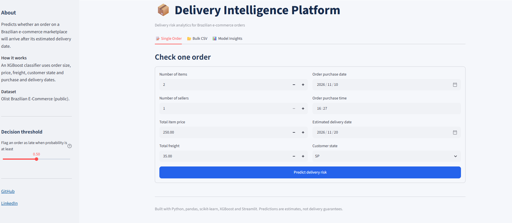
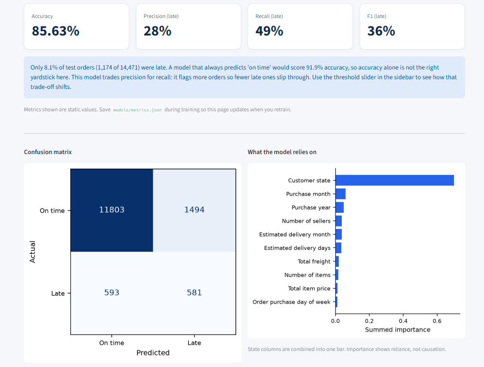
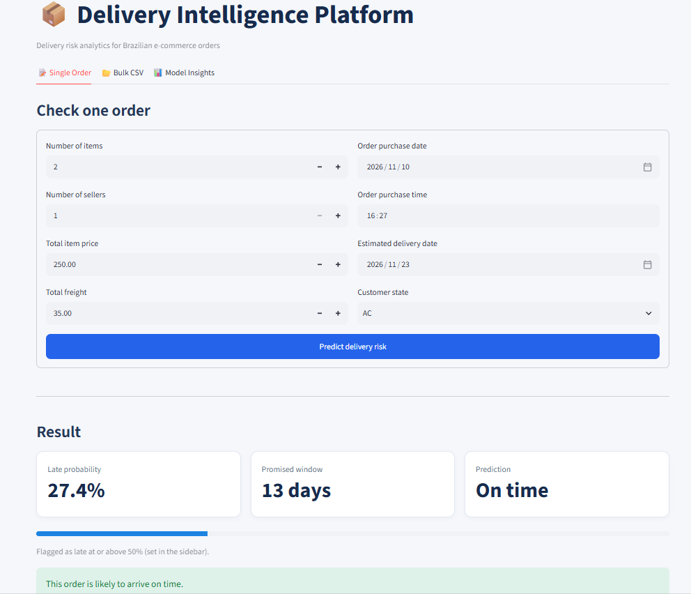
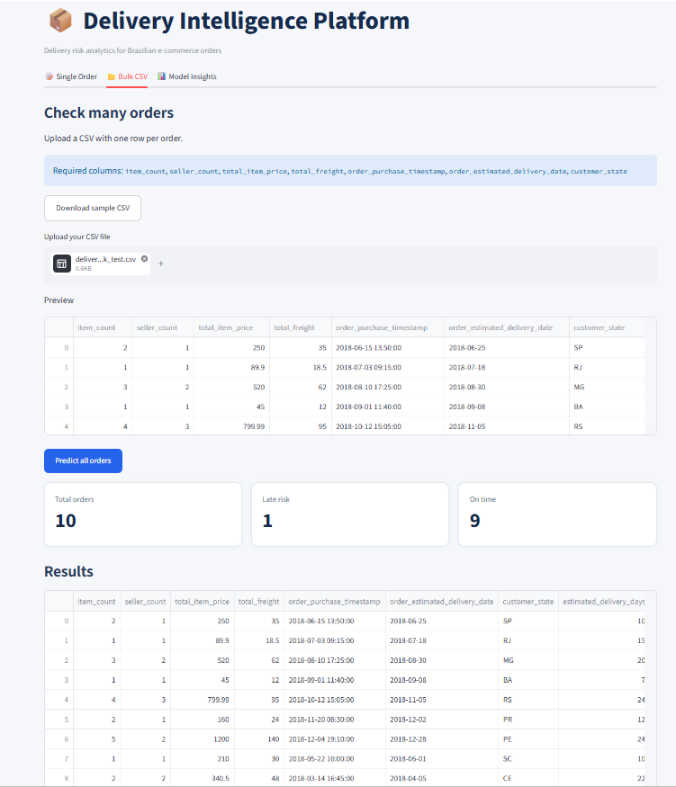

# 📦 Delivery Delay Prediction System

An end-to-end Machine Learning project that predicts the risk of late deliveries for Brazilian e-commerce orders using the **Olist Brazilian E-Commerce dataset**.

The project combines Python, SQL, XGBoost and Streamlit to transform historical order data into actionable delivery-risk predictions.

## 🚀 Live Demo

**[Try the app here](https://delivery-intelligence-akash.streamlit.app/)**

## 📊 Project Overview

Late deliveries can negatively impact customer satisfaction and e-commerce operations.

This project develops a classification model that estimates whether an order is likely to arrive after its estimated delivery date.

**Key capabilities:**
- Predict delivery risk for an individual order.
- Upload CSV files for bulk predictions.
- Estimate late-delivery probability.
- Visualize model performance through an interactive dashboard.
- Explore feature importance and model evaluation metrics.

## 🛠️ Technology Stack

| Category | Tools |
|---|---|
| Programming | Python |
| Data Analysis | Pandas, NumPy |
| Database | MySQL |
| Machine Learning | Scikit-learn, XGBoost |
| Visualization | Matplotlib, Streamlit |
| Model Persistence | Joblib |
| Version Control | Git, GitHub |

## 🧠 Machine Learning Approach

**Algorithm:** XGBoost Classifier

The project follows an end-to-end machine learning workflow:

1. Data extraction from MySQL.
2. Data cleaning and exploratory data analysis.
3. Feature engineering.
4. Categorical encoding and preprocessing.
5. Stratified train, validation and test split.
6. Hyperparameter tuning using RandomizedSearchCV.
7. Model evaluation and threshold selection.
8. Model serialization using Joblib.
9. Real-time and bulk prediction through Streamlit.

### Features Used

- Number of items
- Number of sellers
- Total item price
- Total freight
- Customer state
- Order purchase date and time
- Estimated delivery date
- Derived calendar features

## 📈 Model Performance

Evaluated on a held-out test dataset.

| Metric | Result |
|---|---:|
| Accuracy | 85.63% |
| Precision (Late) | 28% |
| Recall (Late) | 49% |
| F1-Score (Late) | 36% |

### Confusion Matrix

| Actual / Predicted | On Time | Late |
|---|---:|---:|
| On Time | 11,803 | 1,494 |
| Late | 593 | 581 |

The model identifies approximately 49% of actual late deliveries. Precision is 28%, meaning some orders flagged as potentially late will still arrive on time.

Because the dataset is imbalanced, accuracy alone is not sufficient to assess model performance.

## 📊 Application Features

### 1. Single Order Prediction
Enter order details and receive a late-delivery probability and risk classification.

### 2. Bulk CSV Prediction
Upload multiple orders through a CSV file, generate predictions and download the results.

### 3. Model Insights
Explore model evaluation metrics, confusion matrix and feature importance.

## 📁 Project Structure

```text
delivery-delay-prediction-olist/
│
├── app/
│   └── app.py
│
├── data/
│   └── raw/                 # Dataset excluded from Git
│
├── models/
│   └── delivery_delay_xgboost.joblib
│
├── reports/
│   └── figures/
│       ├── late_delivery_rate_by_estimated_days.png
│       └── late_delivery_rate_by_state.png
│
├── src/
│   ├── explore_data.py
│   └── predict.py
│
├── tests/
│   └── test_prediction.py
│
├── load_data.py
├── test_connection.py
├── requirements.txt
└── .gitignore
```

## ⚙️ Installation & Setup

### 1. Clone the repository

```bash
git clone https://github.com/akash9304-VK/delivery-delay-prediction-olist.git
cd delivery-delay-prediction-olist
```

### 2. Create a virtual environment

```bash
python -m venv .venv
```

Activate it on Windows:

```powershell
.venv\Scripts\activate
```

### 3. Install dependencies

```bash
pip install -r requirements.txt
```

### 4. Configure MySQL

- Install and start MySQL.
- Create the `delivery_delay` database.
- Import the Olist dataset tables.
- Configure your database connection securely.
- Execute the SQL view creation script.

### 5. Run the application

```bash
streamlit run app/app.py
```

Open the local Streamlit URL displayed in your terminal.

## ⚠️ Important Model Limitation

The training dataset contains delivered orders only. Therefore, the model learns delivery patterns from orders that were eventually delivered.

Its predictions should be interpreted as estimates of late-delivery risk, not guaranteed outcomes or predictions for orders that are never delivered.

## 📚 Dataset

**Source:** Olist Brazilian E-Commerce Public Dataset.

The dataset contains historical Brazilian e-commerce orders, customers, sellers, payments, products and delivery information.

## 📸 Application Screenshots

### Main Dashboard


### Model Performance


### Single Order Prediction


### Bulk CSV Prediction



## 🚀 Installation & Setup

### 1. Clone the repository

```bash
git clone https://github.com/akash9304-VK/delivery-delay-prediction-olist.git
cd delivery-delay-prediction-olist
```

### 2. Create a virtual environment

```bash
python -m venv .venv
```

Activate it on Windows:

```bash
.venv\Scripts\activate
```

### 3. Install dependencies

```bash
pip install -r requirements.txt
```

### 4. Configure MySQL

- Install MySQL and create a database named `delivery_delay`.
- Import the Olist dataset tables into the database.
- Open `sql/create_views.sql` in MySQL Workbench and execute it.
- Configure your local database credentials as required by the Python scripts.

### 5. Run the application

```bash
streamlit run app/app.py
```

The application will open locally in your browser.

### 6. Try bulk prediction

Upload the included `sample_orders.csv` file under the Bulk CSV tab to test multiple orders.

**Note:** The trained model artifact is included in the repository. The original Olist dataset files are not included; download them separately from the public dataset source.


## 👨‍💻 Author

**Akash Sonwalkar**

Data Analyst | Python | SQL | Power BI | Machine Learning

- GitHub: https://github.com/akash9304-VK
- LinkedIn: https://www.linkedin.com/in/akashsonwalkar/

---

⭐ If you find this project interesting, feel free to explore the repository and share your feedback!